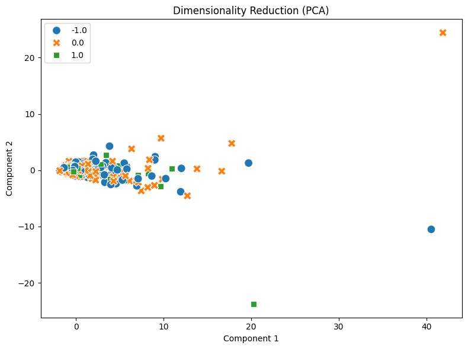
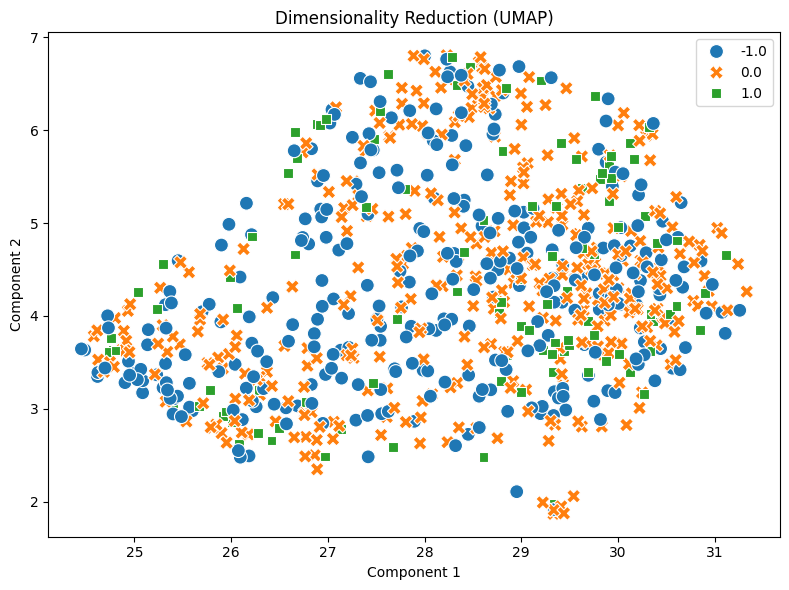
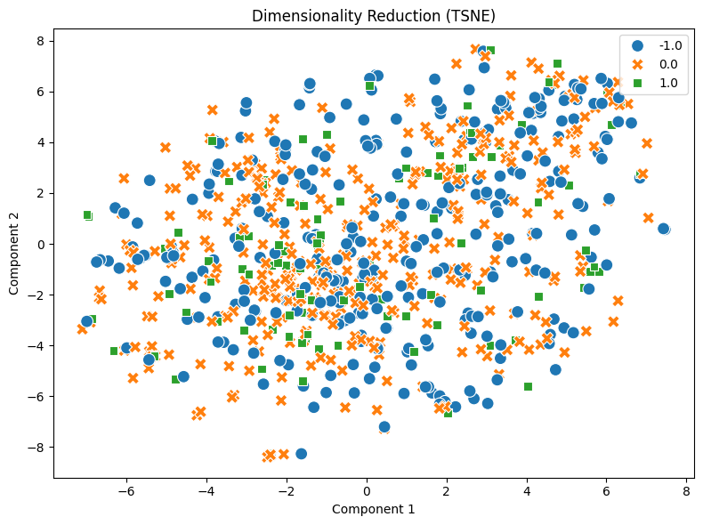

# Your report

   In this session the experiment is done with a dataset of discussions about stocks on the platform Reddit, with each comment labelled with a presumably positive, neutral or negative tone. The dataset went through a few analyses: basic inspection of its attributes, DTM transformation and the sequential correlation recognition, pattern recognition, dimensionality reduction and cosine similarity calculation. 

   Firstly, the number of documents is 847, consisting of 423 of category '0.0', 315 of '-1.0' and 109 entries of '1.0' (load_dataset_1). With a relatively detailed inspection, the result shows that the dataset does not contain empty or missing entries (inspect_data_2)(check_missing_3). Besides, the result also shows that there are 27 single-word counts and 37 length outlier counts, measured with IQR (inspect_data_2). Overall statistics of the data consists of a mean of 147.19, a minimum of 1 character and a maximum of 2737 characters (describe_data_6). Last but not least, there are 34 duplicated counts in the dataset (check_duplicates_4), which were removed afterwards (check_duplicates_5). However, looking in hindsight, the righteousness of the action is questioned, for it discarding both of the duplicated entries and potential single-word entries that might hold information about patterns. Perhaps adding preview of the duplicated documents instead of merely previewing the index will help.

   After building up a DTM with a sparsity of 99.5249% (build_dtm_9), term frequency tool and filters are applied for more insights of the dataset. Concerning term frequency, similar to 20newsgroup, the top 20 consists mostly of stop words like 'the', 'to', 'he' and 'they' (term_frequency_10). The result of variance_filter_tool (variance_filter_11) with a threshold of 0.07 shows similar results, with retained terms being mainly common english words like 'the', 'to', 'and' and 'is'. Next, Pearson and Spearman filters with threshold 0.1 show more characteristic results(pearson_filter_12)(pearson_filter_13)(pearson_filter_14)(spearman_filter_15)(spearman_filter_16)(spearman_filter_17). The '1.0' category correlated terms include 'tldr', 'huge', 'potential' and etc, the '0.0' category including 'year', 'always', 'were', 'sense', 'art' and etc and the '-1.0' category containing 'he', 'his', 'will', 'trump', 'fuck', 'china', 'him', 'economy' and etc. The result is quite interesting, for each outcome offering insights of categories and subtly bestowing common words like 'he' or 'him' non-neutral meanings. 

   Next, a series of pattern mining with filtering method 'tfidf' (patterns_21, patterns_23, patterns_25) show that a fixed support count cannot apply to all three categories. In order to discover 15 patterns, category '1.0' requires a minSup of 5, '0.0' requires minSup = 13 and '-1.0' requires 14. However, the top ranking results of category 1.0 and -1.0 do offer insights while category 0.0 remains ambiguous: category 1.0 contains 'technology' 'good' and 'doing', category -1.0 contains 'trump', 'just' and 'china' and category 0.0 contains 'like', 'just' and 'market'. In addition, applying reduce_dimensions_tool in three methods results in three indistinctive graphs with no prominent clusters (reduce_pca_26, reduce_umap_27, reduce_tsne_28). Lastly, cosine similarity is calculated for three pairs: same topic with same sentiment category (index 35 and 94, cosine_sim_30) cosine similarity = 0.2827, same topic with different sentiment category (index 35 and 236, cosine_sim_31) cosine similarity = 0.375 and random topic with same sentiment category (index 142 and 319, cosine_sim_32) cosine similarity = 0.0909. The results show that similarity between different sentiment is higher than that between same sentiment, presumably implying the impact of topic is bigger than that of sentiment.

   Nevertheless, there are a few drawbacks observed in the experiment. First, after manually checking the labels in the .csv file, there seem to be inconsistencies of the labelled sentiment and the assumed genuine sentiment of the comments. For example, the sarcasm in index 148 “TRUMP is VERY SMART by the TARIFFS... ANAL is MAGA!!!” is overlooked and in turn labelled 'positive 1.0' and in index 226, “...you, a dumbass... sucking the nipple of American propaganda” is labelled '0.0 neutral' while the tone doesn't appear to be so. However, these are based on the writer's own presumption and should be further checked with full context. Secondly, stop words dominate the top ranks for many rankings, hindering meaningful patterns to be observed.

   In conclusion, all 18 tools work on a different dataset provided measurable variable alterations like changing minSup in mine_patterns_tool. Especially, inspect_data_tool, pearson_filter_tool, spearman_filter_tool and mine_patterns_tool reveals characteristic features of the dataset. However, there are some tools whose functionality remain questioned, like check_missing_tool since both results from different datasets show no missing data, whether the tool actually returns a missing data is left unchecked. Additionally, the tools have problem handling special characters and duplicated items professionally. 

 
